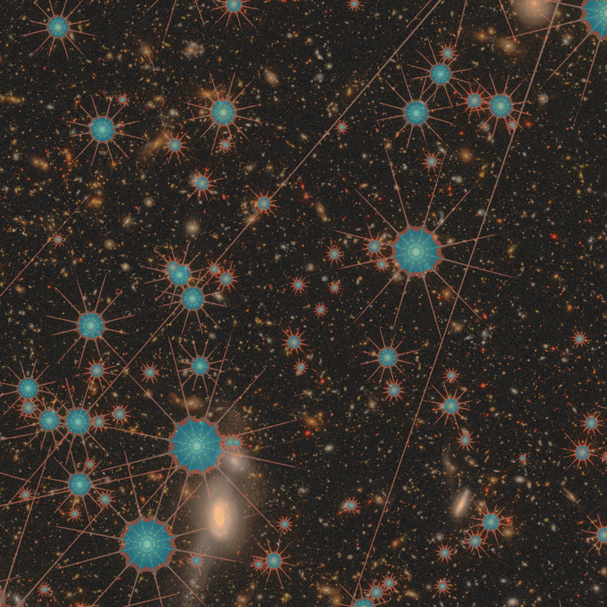

# Asteria 🌌

[](https://pypi.org/project/asteria-roman/)
[](https://pypi.org/project/asteria-roman/)
[](https://github.com/PabloMSanAla/asteria/actions)
[](https://opensource.org/licenses/MIT)
[](https://asteria.readthedocs.io/en/latest/?badge=latest)


<p><strong>Asteria</strong> is a lightweight, high-performance deep learning inference engine and instance deblender for stars in astronomical imaging, powered by boundary-aware <strong>UNet++ (Nested U-Net)</strong>.</p>

<p>Designed for the <strong>Nancy Grace Roman Space Telescope</strong>, Asteria provides promptless, end-to-end star detection in a single neural forward pass.</p>

<p align="center">
  
  <sub><br> Example of <strong>Asteria</strong> star detection on a simulated Roman WFI exposure.</sub>
</p>


---

## Key Features

- **Lightweight & Self-Contained**: Pure PyTorch UNet++ architecture without bulky dependencies or heavyweight vision foundation models.
- **Hardware Acceleration with Automatic Fallback**: Auto-detects and optimizes execution across **NVIDIA CUDA** (with TF32 and AMP), **Apple Silicon MPS** (Metal Performance Shaders on macOS), and universal **CPU**.
- **Physical Boundary-Aware Deblending**: Trained with 3-class supervision:
  - `0`: Sky Background
  - `1`: Source Interior / Core
  - `2`: Deblending Boundary / Contact Interface
- **Seamless Tiled Dense Inference (`predict_dense`)**: Sliding-window 2D Hann/cosine window blending to process arbitrary image sizes (from local cutouts up to full $4088 \times 4088$ Roman WFI exposures) with bounded memory ($< 350$ MB VRAM).
- **Photometric LeakySB Stretch**: Non-linear surface brightness transformation that preserves stellar point-spread functions (PSFs) while lifting faint, diffuse galactic wings.
- **Unified Astronomical I/O**: Direct support for 2D astronomical **FITS** (`.fits`, `.fits.gz`), Roman **ASDF** (`.asdf` Level 2 calibrated exposures and Level 3 mosaics via `roman_datamodels`), and raw **NumPy** arrays. Automatically converts Level 2 exposures to surface brightness units ($\text{MJy/sr}$) using calibrated photometry and enables $\text{ZP}=20.472$.

---

## Installation

### From PyPI
```bash
pip install asteria-roman
```

### From Source
```bash
git clone https://github.com/PabloMSanAla/asteria.git
cd asteria
pip install -e .
```

---

## Quickstart

### 1. Python API

```python
import asteria

# 1. Load pre-trained model (auto-downloads weights on first run, auto-selects device)
segmentor = asteria.load_model("latest")

# 2. Run dense 3-class segmentation inference on a FITS or ASDF exposure
pred_mask, probs, stretched = segmentor.predict_dense(
    "scene_0001_F106.fits",
    tile_size=512,
    overlap=64,
)

# 3. Render publication-ready side-by-side 2-panel figure
fig = asteria.plot_two_panel(
    stretched=stretched,
    pred_mask=pred_mask,
    save_path="prediction.png",
)
```

### 2. Command-Line Interface (CLI)

Asteria includes the `asteria` (and `asteria-predict`) CLI command:

```bash
# Basic prediction and display
asteria scene.fits

# Full-field tiled inference with saving and FITS export
asteria scene.fits \
    --tile_size 512 \
    --overlap 64 \
    --output results.png \
    --export_fits segmap.fits \
    --no_display
```

---

## Model Architecture & Weights History

| Weight Version | Backbone | Resolution | Training Set | Epochs | Interior IoU | Edge IoU (tol=1px) | Macro IoU | Training cutouts | Hardware |
| :--- | :--- | :--- | :--- | :--- | :--- | :--- | :--- | :--- | :--- |
| **`v0.1.0`** (latest) | UNet++ (32-512) | $512 \times 512$ | Roman WFI Synthetic | 80 | **0.754** | **0.513** | **0.6335** | 2800 | NASA NAS GH200 |

For comprehensive architectural details and benchmark comparisons, see the [Asteria Documentation](https://asteria.readthedocs.io).

---

## License

This project is licensed under the MIT License - see the [LICENSE](LICENSE) file for details.
